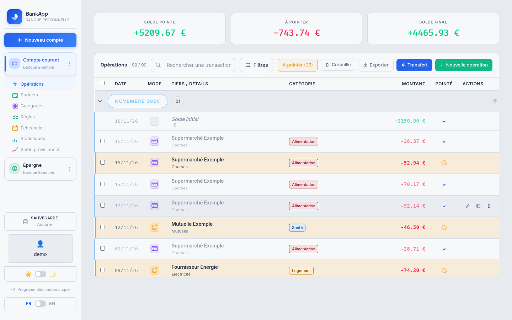
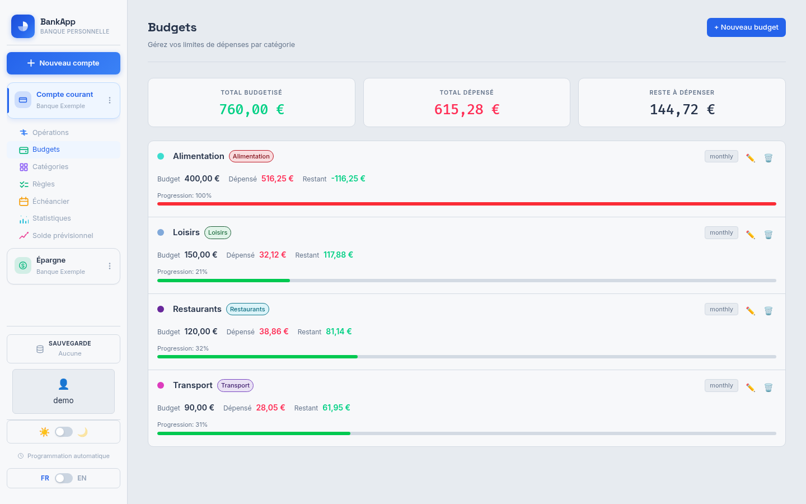
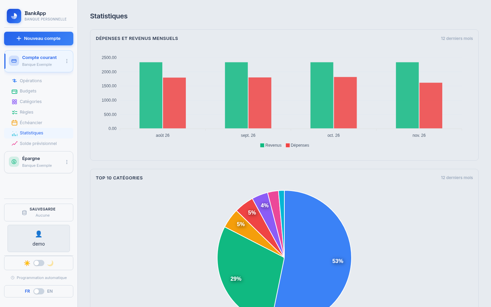
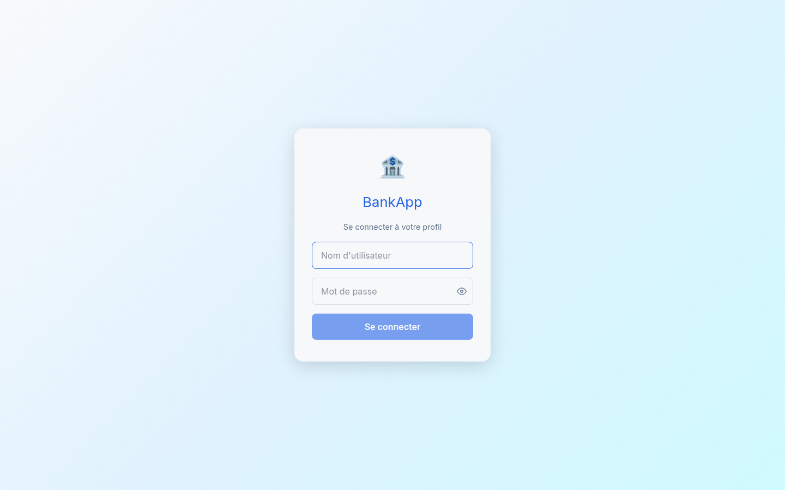

# BankApp 💰

A powerful personal finance management platform to organize, categorize, and analyze your bank transactions across multiple accounts.

> **Self-hosted and free.** BankApp is software you run yourself. It is not a bank, it does not connect to bank accounts, and it sends your data nowhere.
> You are responsible for the server, the backups and the `ENCRYPTION_KEY` that protects them.

 

## 📸 Screenshots

The screenshots use a fictional demo account (names, amounts and dates are invented).

| Operations | Budgets |
|---|---|
|  |  |
| **Statistics** | **Login** |
|  |  |

---

## ✨ Features

### 📊 Core Functionality
- **Multi-Account Management** – Manage multiple bank accounts with real-time balance tracking
- **Smart Categorization** – Automatically categorize transactions using customizable rules
- **CSV Import** – Import bank statements (BankPerfect format with `;` separator)
- **Transaction Search** – Accent-insensitive search across merchant names and details
- **Recurring Transactions** – Schedule and track monthly, quarterly, semi-annual, and annual expenses
- **Budgets** – Set spending limits per category/account (daily, weekly, monthly, or yearly period) with a custom color per budget
- **Financial Statistics** – 12-month trends, expense breakdown by category, savings rate analysis
- **Soft Delete** – Transactions go to trash for 30 days before permanent deletion (recovery window)
- **Transfers** – Record transfers between your own accounts
- **Backup & Restore** – Every user can snapshot their own account data on demand; admins can additionally create/download full-database backups. Restore transactions, categories, rules, or the scheduler to the current account (with an automatic safety snapshot first) or to a brand-new account. All backups are encrypted at rest (see Security below).

### 🔐 Security & Privacy
- **Username/Password Authentication** – bcrypt-hashed passwords, no anonymous/no-auth mode
- **Two-Step Verification (optional)** – TOTP codes (any authenticator app), ten one-time recovery codes, and a "remember this device" option for 20 days. Enabled per user from the profile menu.
- **Role-Based Access** – Admin and user roles; only admins can create/rename/delete user accounts or reset another user's password
- **Session Lock** – Auto-lock after 15 minutes of inactivity, requires password to unlock
- **Encrypted Backups** – All backups (manual, per-account, and automated) are encrypted at rest with AES-256-GCM
- **Strict Data Isolation** – Every account/transaction/schedule/budget/backup is scoped to its owning user
- **No Cloud Sync** – Your data stays on your infrastructure (self-hosted only)

### 🌍 Internationalization & UI
- **Multi-Language** – French (FR) and English (EN) fully supported
- **Dark/Light Mode** – Persistent theme preference, with optional automatic day/night scheduling
- **Responsive Design** – Works on desktop and tablet

---

## 🚀 Quick Start

### Prerequisites
- [Docker](https://www.docker.com/) & [Docker Compose](https://docs.docker.com/compose/)
- Git

### Installation

```bash
# Clone the repository
git clone https://github.com/Lejooohn/bankapp.git
cd bankapp

# Create your env file (see Configuration below for what each variable does)
cp .env.example .env   # or create it by hand — see Configuration
# At minimum, set POSTGRES_PASSWORD and ENCRYPTION_KEY; both are required, the
# stack refuses to start without them. ENCRYPTION_KEY must not be all zeros.

# Build and start containers (Postgres, backend, frontend, backup sidecar)
docker-compose up -d --build

# Wait ~15 seconds for healthchecks, then open:
# Frontend: http://localhost:5173 (WEB_PORT)
# Backend API: http://127.0.0.1:3000/api/health (loopback only)

# Production deployment: see docs/DEPLOYMENT.md
```

**First login:** the very first account is created via the registration screen when the database is empty. Every subsequent account must be created by an admin from the user management panel.

Outside production (`NODE_ENV` not `production`), an empty database also gets a development account named `admin` with the password `admin`. It has the `user` role, not the admin role, and it is never created in production. Change or remove it before exposing a development instance.

### Stopping

```bash
docker-compose down
```

---

## 📖 Usage Guide

### 1. Create Your First Account

1. Click **"Nouveau compte"** (New Account)
2. Enter account name (e.g., "Checking Account")
3. Optionally add bank name and description
4. Click **"Créer le compte"** (Create Account)

The account appears in the left sidebar. Click to view transactions.

### 2. Import Transactions from CSV

1. In an account, click **"Importer un CSV"** (Import CSV)
2. Select a BankPerfect export file (`;`-separated CSV)
3. Expected columns: `Date`, `Merchant/Tiers`, `Amount`, `Type`, `Details`
4. Click **"Importer"** (Import)
5. Transactions appear immediately in the transaction list

**CSV Format Example:**
```
Date;Tiers;Amount;Type;Details
2024-01-15;Amazon;-49.99;Carte;Purchase
2024-01-16;Salary;+2500.00;Versement;Monthly salary
```

### 3. Categorize Transactions

#### Manual Categorization
- Click on a transaction's **"Catégorie"** (Category) field
- Select or create a new category
- Changes save automatically

#### Auto-Categorization with Rules
1. Go to **"Règles"** (Rules) tab
2. Click **"Nouvelle règle"** (New Rule)
3. Enter patterns (pipe-delimited, e.g., `Amazon|AWS|Amazon Prime`)
4. Select target category
5. Click **"Appliquer aux opérations"** (Apply to Transactions)
6. Preview which transactions match, then confirm

Rules apply to the `Tiers` (merchant) and `Details` fields. Matching is **accent-insensitive** (e.g., "Crédit" matches "credit").

### 4. Track Recurring Expenses

1. Go to **"Échéancier"** (Scheduler)
2. Click **"Nouvelle échéance"** (New Scheduled Transaction)
3. Configure:
   - **Description** – What is this expense?
   - **Amount** – Positive (income) or negative (expense)
   - **Frequency** – Monthly, Quarterly, Semi-annual, Annual
   - **Day of Month** – Which day (1-31, auto-adjusts if month is shorter)
   - **Start Date** – When does it start?
   - **Shift if Weekend** – Automatically move to next Monday if it falls on weekend?
4. Click **"Créer l'échéance"** (Create)

The scheduler shows an interactive calendar with:
- Upcoming occurrences highlighted
- Completed/pending counts
- A **"Générer pour le mois prochain"** (Generate Next Month) button to auto-create transactions

### 5. Set a Budget

1. Go to **"Budgets"**
2. Click **"Nouveau budget"**
3. Configure a name, amount, currency, period (daily/weekly/monthly/yearly), optional category and color, and an optional end date
4. Track spending against the budget from the same view

### 6. View Statistics

Click **"Statistiques"** (Statistics) to see:
- **KPIs**: Reconciled balance, pending balance, initial/final balance
- **Monthly Averages**: Income, expenses, savings rate
- **12-Month Trends**: Balance evolution, income vs. expenses
- **Expense Breakdown**: Pie chart by category with top categories listed

---

## 🔧 Configuration

### Environment Variables

Create a `.env` file in the project root (gitignored, never commit it) — see `.env.example` for a template:

```env
# Required — Postgres role password. Compose reads this via variable substitution
# to build DATABASE_URL and to set the actual Postgres role password; the stack
# refuses to start if it's missing.
POSTGRES_PASSWORD=choose_a_strong_password

# Required — used to encrypt every backup and every two-step verification secret
# at rest (AES-256-GCM). Must be exactly 64 hex characters (32 bytes), and not
# all zeros. Never reuse this key anywhere else, and never commit it. Losing it
# makes existing backups and second-factor secrets unreadable.
ENCRYPTION_KEY=64_character_hex_string_here

# Required in practice — comma-separated list of frontend origins allowed to call
# the API cross-origin. Requests from any other origin get a 403.
CORS_ORIGINS=http://localhost:5173

# Optional — where backups are stored (defaults to /backups inside the container)
BACKUP_DIR=./backups

# Optional — stack names and ports (defaults in parentheses)
CONTAINER_PREFIX=bankapp   # container names: <prefix>-db, -api, -web, -backup
PGDATA_VOLUME=bankapp-pgdata # external volume holding the database; create it by hand
NETWORK_NAME=bankapp-net   # external Docker network
WEB_PORT=5173                   # published web port (container listens on 8080)
API_PORT=3000                   # published API port (loopback only)
DB_PORT=5433                    # published PostgreSQL port (loopback only)

# Optional — reverse proxies in front of the stack. X-Forwarded-For is trusted only
# from these addresses; the API trusts one hop (the web container).
TRUSTED_PROXY_CIDR=172.16.0.0/12   # address range of the proxy (web container)
TRUST_PROXY_HOPS=1

NODE_ENV=production
PORT=3000
```

**To generate a secure `ENCRYPTION_KEY`:**
```bash
node -e "console.log(require('crypto').randomBytes(32).toString('hex'))"
```

### Language & Theme Persistence

- **Language** (FR/EN) and **Dark/Light Mode** are automatically saved to browser localStorage
- Changes persist across sessions
- Toggle using the buttons in the top-right corner of the dashboard

---

## 🏗️ Project Architecture

### Tech Stack

**Backend** (Node.js 26 image):
- Express 5.3, TypeScript 7 (ESM)
- PostgreSQL 18 (`pg` 8)
- Validation: Zod 4 for requests; calendar and budget rules shared through `shared/`
- Second factor: TOTP (RFC 6238) implemented with `node:crypto`, no extra dependency
- CSV parsing, cron jobs, PDF generation
- Vitest 5 for unit and route tests

**Frontend** (served by nginx in production):
- Svelte 5.57, Vite 8.3, Tailwind CSS 4.3, TypeScript 5.9
- ApexCharts for statistics; `qrcode` for the second-factor enrolment code

**Database:**
- PostgreSQL 18, one named volume, external to compose
- Trigram indexes for accent-insensitive search
- Automatic, additive migrations declared in `backend/src/db.ts` (`CREATE TABLE IF NOT EXISTS`, `ADD COLUMN IF NOT EXISTS`)

### File Structure

```
bankapp/
├── backend/
│   ├── src/
│   │   ├── index.ts              # App setup, auth middleware, router mounts, cron jobs, boot
│   │   ├── db.ts                 # Database schema and additive migrations
│   │   ├── routes/               # One router per domain
│   │   │   ├── auth.ts               # Login, second factor, enrolment, password change
│   │   │   ├── admin.ts              # User management, password and second-factor resets (admin)
│   │   │   ├── me.ts, about.ts       # Current user, version and build information
│   │   │   ├── accounts.ts, transactions.ts, categories.ts, rules.ts, schedules.ts, budgets.ts
│   │   │   ├── stats.ts, export.ts, import.ts
│   │   │   ├── backup-restore.ts     # Account snapshots, restore (full dumps: admin only)
│   │   │   ├── backup-status.ts      # Backup inventory and WAL status (admin)
│   │   │   └── events.ts             # Server-sent events (real-time updates)
│   │   ├── services/
│   │   │   ├── encryption.ts             # AES-256-GCM helpers for every encrypted file
│   │   │   ├── totp.ts, mfa.ts           # RFC 6238 codes; recovery codes, device cookie, secret storage
│   │   │   ├── backup-create.ts          # Full-database backup creation (admin)
│   │   │   ├── backup-restore-extract.ts # Parses a pg_dump for a selective restore
│   │   │   ├── backup-restore-apply.ts   # Applies a restore inside one transaction
│   │   │   ├── backup-auto-encrypt.ts    # Encrypts the sidecar's plaintext dumps
│   │   │   └── wal-monitor.ts, retry.ts, schedule-generate.ts, budgets.ts
│   │   ├── lib/
│   │   │   ├── shared.ts             # Rate limits, ownership checks, errMsg, token hashing
│   │   │   ├── schemas.ts            # Zod request schemas
│   │   │   └── security-headers.ts   # API response headers, TRUST_PROXY_HOPS parsing
│   │   ├── security/                 # Tests: security regressions through the app, MFA flow
│   │   └── config/infra.test.ts      # Tests: compose, Dockerfiles, nginx, schema guards
│   ├── test/harness.ts               # Fake database and HTTP harness for route tests
│   ├── Dockerfile                    # Stages: prod (compiled output), dev (tsx watch)
│   └── package.json
├── frontend/
│   ├── src/
│   │   ├── App.svelte                # Root component (auth, lock timeout)
│   │   ├── components/               # Views, modals, Login.svelte, MfaSettingsModal.svelte
│   │   ├── lib/
│   │   │   ├── api.js                # HTTP client, token storage, second-factor calls
│   │   │   ├── i18n.ts               # French and English strings
│   │   │   └── theme.ts              # Dark/light mode
│   │   └── utils/categoryColor.js
│   ├── public/theme-init.js          # Theme applied before first paint (no inline script)
│   ├── deploy/                       # nginx template and security headers (production image)
│   ├── Dockerfile                    # Development image (Vite)
│   ├── Dockerfile.prod               # Production image (vite build, nginx)
│   └── package.json
├── shared/                           # Calendar and budget rules shared by backend and frontend
├── docs/                             # API, database, deployment, restore runbook, migration notes
├── scripts/                          # Backup and restore scripts
├── CHANGELOG.md
├── docker-compose.yml                # Production stack: postgres, backend, frontend, backup sidecar
└── .env                              # Configuration (gitignored)
```

---

## 🐳 Reverse Proxy & Backups

### Reverse Proxy (Optional but Recommended)

If the app is reached beyond your local network, put a TLS-terminating reverse proxy in front of the web port
(`WEB_PORT`). The web container also proxies `/api` itself, so the proxy needs one route:

```nginx
server {
    listen 443 ssl;
    server_name bankapp.example.com;

    ssl_certificate /path/to/cert.pem;
    ssl_certificate_key /path/to/key.pem;

    location / {
        proxy_pass http://localhost:5173;   # WEB_PORT
        proxy_set_header Host $host;
        proxy_set_header X-Forwarded-For $proxy_add_x_forwarded_for;
        proxy_set_header X-Forwarded-Proto $scheme;
    }
}
```

- Add `https://bankapp.example.com` to `CORS_ORIGINS` once the domain is live.
- Set `TRUSTED_PROXY_CIDR` to the address range this proxy connects from, so the real client address is used for
  rate limits. Check the web container's access log after the change.
- The "remember this device" cookie of two-step verification is `Secure`: browsers only keep it over HTTPS (or on
  `localhost`). Use the HTTPS address for daily use.

### Backups

Automated daily/weekly/monthly PostgreSQL backups run on the schedule configured on the `backup` service (default `SCHEDULE` in `docker-compose.yml`), stored under `./backups/{daily,weekly,monthly}`. A background sweep inside the backend encrypts any new plaintext dump it finds there within 15 minutes. Any authenticated user can also snapshot their own account on demand; admins can additionally create/download/delete full-database backups from the UI (stored under `./backups/last`). See **Security** below for details.

`bash scripts/backup.sh` (run from the project folder) makes an extra encrypted dump in `backups/manual/`. There is no automated restore test: see `docs/RESTORE_RUNBOOK.md` to test a restore by hand.

---

## 🔍 Common Tasks

### Export Transactions

1. Select transactions (or **"Tout sélectionner"** for all)
2. Click **"Exporter"** (Export) button
3. Choose format and date range
4. Download as CSV or PDF

### Reconcile Transactions

Click the **"Pointé"** (Reconciled) checkbox on each transaction to mark it as reconciled. This affects the "Solde pointé" (Reconciled Balance) KPI.

### Restore Deleted Transactions

1. Go to **"Corbeille"** (Trash)
2. Select transactions to restore
3. Click **"Restaurer"** (Restore)
4. Transactions go back to their original account

*Note: Transactions are permanently deleted after 30 days.*

### Set Default Account

1. Click the account menu (⋮)
2. Click the star icon (☆ → ⭐) to set as default
3. Default account loads automatically when you open the app

### Back Up Your Own Data

1. Select an account, then click the **Backup** widget in the left sidebar to expand it
2. Click **"Sauvegarder mes données"** to snapshot this account's categories, rules, schedules, and transactions on demand
3. Every user can do this for their own accounts; it doesn't require admin rights

### Create/Download a Full Database Backup (Admin Only)

1. As an admin, expand the **Backup** widget and click **"Sauvegarder maintenant"** to trigger a full `pg_dump` of the entire database
2. Download it for offline/off-site storage — the download is decrypted on the fly into a plain, restorable `.sql.gz`
3. Regular users cannot create, list, or download full-database backups, since they contain every user's data

### Restore from a Backup

1. Select an account, then click the **Backup** widget in the left sidebar to expand it
2. Pick a backup (or a "Avant restauration" safety snapshot) and click **"Restaurer"**
3. Choose which data to restore (Opérations, Catégories, Règles, Échéancier)
4. Choose a destination:
   - **Nouveau compte** – restores into a brand-new account, leaving everything else untouched (safe to try)
   - **Compte actuel** – overwrites the selected data on the current account; type `RESTAURER` to confirm
5. Restoring onto the current account automatically saves a safety snapshot first, so you can undo the restore by restoring that snapshot afterward

*Safety snapshots are scoped to the account they were taken from and can only be restored back onto that same account. Full database dumps can be restored only by an admin, because they contain every user's data; a regular user restores only their own rows from them.*

### Turn On Two-Step Verification

1. Open the profile menu and choose **Double authentification** (available once you are signed in).
2. Enter your password, then scan the QR code with an authenticator app (Google Authenticator, Aegis, 1Password…), or type the key shown below it.
3. Enter the 6-digit code the app shows. You get ten recovery codes: download the text file and store it outside this computer. Each code works once.
4. From now on, signing in asks for a code. Tick **Se souvenir de cet appareil pendant 20 jours** to skip the step on this browser for 20 days.

To turn it off, enter your password and a current code (or a recovery code). If you lose your phone and your recovery codes, an admin can reset the factor with `POST /api/admin/users/:id/mfa/reset` (there is no button for it in the interface yet).

*Changing your password, or an admin resetting it, ends all trusted devices.*

---

## 🐛 Troubleshooting

### "Unable to contact server" Error
- Check backend logs: `docker-compose logs backend`
- Ensure PostgreSQL is running: `docker-compose ps`
- Verify `DATABASE_URL` / `POSTGRES_PASSWORD` are correct in `.env`

### Stack Won't Start / "POSTGRES_PASSWORD must be set"
- `POSTGRES_PASSWORD` and `ENCRYPTION_KEY` are required — the compose file fails fast if either is missing from `.env`

### API Calls Blocked / CORS Error in Browser Console
- Add the exact origin you're browsing from (scheme + host + port) to `CORS_ORIGINS` in `.env`, then recreate the backend container

### Transactions Not Importing
- Verify CSV format: `;`-separated (not comma)
- Required columns: `Date`, `Tiers`, `Amount`
- Check date format (YYYY-MM-DD)

### Login Issues
- New installs outside production: the development account `admin` / `admin` exists (see Quick Start; it is not an admin), or register the first account if the database is empty
- After the first account exists, only an admin can create new users — ask an admin to add you from the user management panel
- 5 login requests from the same address within 30 minutes return `429`. Five wrong passwords for one username from one address do the same for that pair. Both are in memory and reset when the backend restarts. There is no lockout for other clients.
- Passwords must be at least 12 characters with an uppercase letter, a lowercase letter, and a digit

### Second-Step Problems
- **"Code incorrect"**: the phone clock may be out of sync (enable automatic time on the phone), or the code is from an earlier step. Each code works once; wait for the next one.
- **"Vérification expirée"**: the challenge lasts 5 minutes or was replaced by a newer sign-in. Sign in again.
- **Asked for a code on every sign-in**: the device cookie is not kept. Check that you use the HTTPS address, and that the browser accepts cookies.
- **Lost phone and recovery codes**: an admin resets the factor through the API (see above). Then enrol again.
- **Signing in fails for an account with two-step verification**: the `ENCRYPTION_KEY` must be the key the secrets were stored with; a changed key makes them unreadable.

### Dark Mode / Language Not Persisting
- Clear browser cookies/localStorage: `localStorage.clear()` in console
- Refresh page

### Slow Transaction Loading
- App loads 100 transactions per page by default
- Scroll down to load more
- Use search to filter transactions (faster)

### Database Migration Failed
- Check PostgreSQL logs: `docker-compose logs postgres`
- Ensure database user has permissions
- Delete and recreate containers if necessary: `docker-compose down -v && docker-compose up -d`

---

## 🤝 Contributing

Contributions welcome! Please:

1. **Fork & Clone:**
```bash
git clone https://github.com/Lejooohn/bankapp.git
cd bankapp
```

2. **Create Feature Branch:**
```bash
git checkout -b feature/my-feature
```

3. **Make Changes & Test:**
```bash
docker-compose up -d --build
# Dev stack: the frontend container keeps its node_modules in the image. After a change to
# frontend/package.json (or backend/package.json), rebuild that service, or Vite cannot resolve the new package:
#   docker-compose --env-file .env.local -f docker-compose.local.yml up -d --build frontend
# Make changes, test locally
cd backend && npx tsc --noEmit && npm test   # type check, then 122 Vitest tests
cd shared && npm test                        # 27 tests: calendar and budget rules
cd frontend && npm run build                 # no frontend test runner yet; the build must pass
```

4. **Commit & Push:**
```bash
git add .
git commit -m "Add: Description of changes"
git push origin feature/my-feature
```

5. **Open Pull Request** on GitHub

### Code Conventions

- **Backend:** One change = one commit (e.g., "Fix search accents", "Add schedule frequency")
- **Frontend:** Link backend + frontend changes in single commit if related
- **Validation:** Always use Zod for input validation
- **Errors:** Use the `errMsg()` helper (dev vs. prod error messages)
- **Dates:** Use `parseLocalDate()` to avoid timezone issues
- **Translations:** Add keys to `i18n.ts` + use `$t()` in templates
- **Ownership checks:** Every endpoint that reads/writes account-scoped data must verify the requester owns that account before touching it
- **Security regressions:** a fix comes with a test that fails on the previous code (see `backend/src/security/`)
- **Changelog:** every change goes under `## [Unreleased]` in `CHANGELOG.md`, in the same commit (see `docs/versioning.md`)

---

## 📋 Roadmap

- [ ] Mobile app (React Native)
- [ ] Real-time WebSocket sync for multi-tab updates
- [ ] Advanced exports (QuickBooks, YNAB integration)
- [ ] Budget alerts (notify when approaching/exceeding a budget)
- [ ] Broader automated test coverage (the backend has 122 Vitest tests, including route tests through the real app for auth, restore and transactions; the frontend has none, only build checks)
- [ ] OpenAPI/Swagger documentation
- [ ] SSO / OAuth login (in addition to the existing username/password auth)
- [ ] Email notifications
- [ ] TLS on the PostgreSQL connection itself (currently relies on the Docker network being private)

---

## 🔐 Security

This section describes the security posture as it is: what is implemented, and what is not. The last
audit (2026-11-16) and its open points are in `CHANGELOG.md` and `docs/api.md`.

### Authentication
- Username and password. Passwords are hashed with **bcrypt** (cost 10) and never logged.
- Password policy aligned with **PCI DSS v4.0 requirement 8.3.6**: at least 12 characters, with an uppercase letter, a lowercase letter and a digit.
- **Optional second factor (TOTP, RFC 6238)**: the secret is encrypted with `ENCRYPTION_KEY`. Recovery codes and challenge and device tokens are stored as SHA-256 hashes. A code is accepted once (the step is recorded). A challenge allows five attempts and lasts five minutes.
- Trusted devices: an `HttpOnly`, `Secure`, `SameSite=Strict` cookie for 20 days. Changing the password, an admin password reset or an admin factor reset ends them.
- Enrolling or disabling the factor, and changing the password, asks for the current password. Confirming the factor ends the user's other sessions.
- Sessions are random 256-bit tokens (not JWTs). Only their SHA-256 hash is stored. They expire after 8 hours.
- Rate limits are in memory and per process (details in `docs/api.md`). They are a brake on guessing, not a guarantee: they reset on restart.
- **Trade-off, chosen deliberately:** there is no account-wide lockout. A lockout keyed on a counter lets anyone lock the owner out. Accounts **without** a second factor therefore have no account-wide cap on password guessing from many addresses. Enabling the second factor is the protection for an account.
- The frontend locks after 15 minutes of inactivity and asks for the password to unlock.

### Authorization & Data Isolation
- Two roles: `admin` and `user`. Admins manage users (create, rename, reset a password, reset a second factor, delete). Admin rights never grant access to another user's financial data.
- Every account-scoped endpoint checks that the requester owns the account or resource before reading or writing. The transaction lock lookup is scoped too.
- Full-database backups and full-dump restores are **admin only**. A restore writes only the requester's own rows.
- Registration is open only when the database has no users. Every later account is created by an admin.

### Backups
- **Every backup is encrypted at rest with AES-256-GCM**: full dumps, account snapshots, and the scheduled dumps of the `postgres-backup-local` sidecar (a sweep in the backend encrypts them within 15 minutes).
- Downloads and restores decrypt on the fly. A downloaded `.sql.gz` is a normal Postgres dump.
- Each restore request stages its data in its own schema, dropped at the end of the request.
- `ENCRYPTION_KEY` must be unique per environment, never committed, and kept outside the server. The all-zero placeholder is refused.

### Network and Browser
- CORS is limited to `CORS_ORIGINS`. Other origins get a clean `403`.
- PostgreSQL and the API are published on the loopback address only; the web container is the public entry point and proxies `/api`.
- The API sends `nosniff`, `X-Frame-Options: DENY`, a referrer policy and `Cross-Origin-Resource-Policy`. The web image sends a Content-Security-Policy that allows same-origin scripts only and no inline script.
- `X-Forwarded-For` is taken from the proxy only when the connection comes from `TRUSTED_PROXY_CIDR`; the web container overwrites it with the connection address.
- Error responses to clients never contain raw database messages (`errMsg()`).
- The stack does not rely on IPv6.

### Known limitations (not yet implemented)
- **Session token in the browser's `localStorage`.** Cross-site scripting could read it. The Content-Security-Policy and the absence of inline scripts reduce that risk. Moving the session to an `HttpOnly` cookie would remove it, and is a larger change to the sign-in flow.
- **Guessing without a second factor** is not capped account-wide (see Authentication). Wrong guesses from many addresses are not slowed beyond the per-address limits.
- **Rate limits are in memory.** A restart resets them.
- **CSV import has no duplicate check.** Importing the same statement twice creates the operations twice.
- **Second-factor email or hardware keys are not supported**; only TOTP and recovery codes.
- **No TLS on the PostgreSQL connection.** Backend and database rely on the private Docker network.
- **No column-level encryption in the database.** Only backups are encrypted at rest; live balances and transactions are plain in PostgreSQL.
- **Second-factor device trust needs HTTPS.** Over plain HTTP the browser does not keep the `Secure` cookie, so the code is asked on every sign-in.

### Other
- **No Cloud Sync** – Data never leaves your infrastructure.
- **Self-Hosted Only** – Full control over your financial data.
- **Soft Delete** – Deleted transactions are recoverable for 30 days (basic audit trail), then purged.

---


## 📄 License

GNU Affero General Public License v3.0 (AGPL-3.0) – See [LICENSE](LICENSE) for details.

If you run a modified version of BankApp as a network service, you must offer its source code to the users of that service.

---

## 💬 Support & Questions

For issues or questions:
- Check the [Troubleshooting](#-troubleshooting) section
- Review [Common Tasks](#-common-tasks)
- Open a [GitHub Issue](https://github.com/Lejooohn/bankapp/issues)

---

**Made with ❤️ for personal finance management.**
